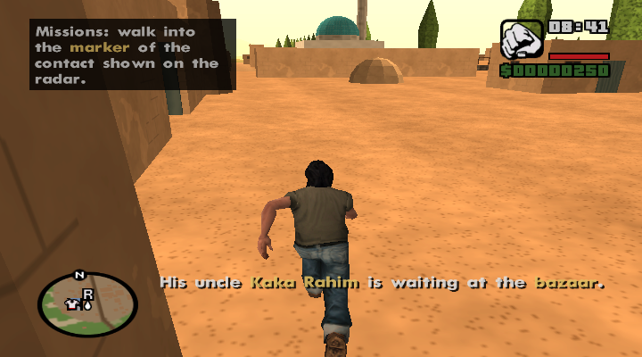
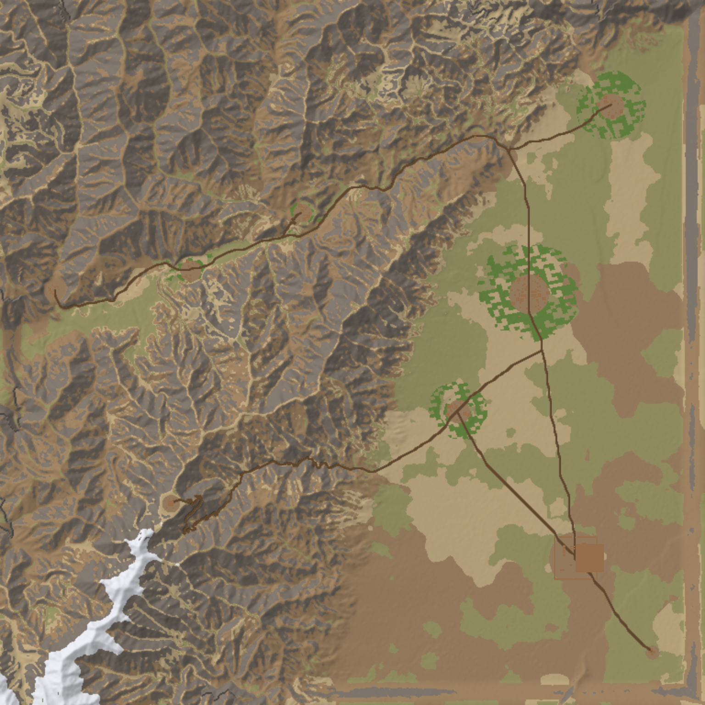

# GTA San Andreas – Afghanistan: "The Valley"

A total-conversion mod for **classic GTA San Andreas (PC)**. It replaces the San Andreas map with a
36 × 36 km slice of real Afghan terrain (the Shomali plain and the Ghorband valley north of Kabul,
scaled 1:6). It adds a new 8-mission story, original Afghan-style music, new zone names, a
dry-highland weather cycle, character outfits and a new radar map.



> **Status: version 1.0.1.** The game starts and loads into the map (tested under Wine on Linux): you spawn in
> Qala-e-Naw with the mission hints, radar markers and text working. The 8 missions have not been played through
> yet, so please report what happens. See [CHANGELOG.md](CHANGELOG.md).



## What's in it

| Area | Content |
|---|---|
| **Map** | Real elevation data (SRTM), 576 terrain tiles + 144 LOD tiles, dirt roads routed through the mountains with switchbacks, irrigated fields, poplar-lined roads, orchards |
| **Places** | Qala-e-Naw (town, bazaar, mosque, police station, your safehouse), Camp Sangar (army base with runway, hangars, helipads), villages Deh-e-Bagh, Dara-e-Sabz, Sar-e-Kotal, Shahrak, Darwaza Checkpoint, Sang-e-Siah bandit camp, Qala-e-Kohna mountain fortress, Burj-e-Khak ruins |
| **Buildings** | 28 new models: mud-brick *qala* compounds with towers, houses, mosques with turquoise domes and minarets, bazaar stalls, watchtowers, HESCO walls, guard towers, tents, hangars, fortress, ruins, trees |
| **Story** | 8 missions: *Homecoming, Market Day, Medicine for Shahrak, Darwaza, Aid Convoy, Black Stone, Eagle's Nest, Qala-e-Kohna* – see [docs/STORY.md](docs/STORY.md) |
| **People** | Villagers (men, women, elders), farmers, police at the checkpoint, soldiers at the base, Black Stone bandits – all reuse SA's rural/desert peds |
| **Character styles** | Wardrobe in your courtyard: villager, farmer, shepherd, city clothes (CJ), police volunteer (after mission 4), army fatigues (after mission 5) |
| **Music** | 6 original instrumental tracks (rubab, dutar, nay flute, tabla, dhol, harmonium drone in Afghan modes and rhythms such as *mughulchi* 7/8 and *attan*), played by an in-car radio |
| **Atmosphere** | New timecyc: deep-blue high-altitude sky, dusty horizon, golden dawn/dusk, longer view distance; weather cycle with clear days, haze, rare dust storms and rain |
| **Vehicles** | Parked pickups, sedans, motorbikes and tractors in towns; police pickups at the checkpoint; army jeeps, trucks, Cargobob and Dodo at the base; Hunter + Rhino unlocked at the end |
| **UI** | New zone names, radar map, renamed vehicles (Police Pickup, Army Jeep, Army Truck, Desert Pickup) |

## Install

### What you need

1. **Your own copy of GTA San Andreas PC (classic, not the *Definitive Edition*)** with the **1.0 US executable**.
   This is the only thing the download cannot include – see [Getting the 1.0 US exe](#getting-the-10-us-exe).
2. Everything else is bundled in the download and installed for you if it is missing:
   **ModLoader 0.3.10**, **CLEO 5.4.0** (with Silent's ASI Loader) and **SilentPatch** (all MIT-licensed, see
   `requirements/`).

### Steps

1. Download `AfghanistanMod-v1.0.1.zip` and unzip it anywhere.
2. Back up your saves (`Documents\GTA San Andreas User Files`) if you care about them: saving in this mod can
   overwrite save slots.
3. Run the installer and select your GTA San Andreas folder (the one with `gta_sa.exe`):
   - **Windows:** double-click **`INSTALL.bat`**.
   - **Linux (Wine) / macOS:** `python3 install.py "/path/to/GTA San Andreas"`
4. Start `gta_sa.exe` and choose **New Game**. Old saves will not work.

The installer:
- stops with instructions if `gta_sa.exe` is not the 1.0 US executable;
- installs ModLoader, CLEO 5 and SilentPatch, but only those that are not already there. CLEO's ASI loader replaces
  `vorbisFile.dll`; your original is backed up to `_afghanmod_backup\` first (CLEO also keeps it as `vorbisHooked.dll`);
- turns off ModLoader's *AutoRefresh* in `modloader\.data\config.ini` (it fails under Wine and on network drives);
- adds the mod in new folders only:
  - `modloader\afghanistan\` – models, textures, radar, `gta.dat`, `timecyc.dat`, `water.dat`, `main.scm`, `afghan_limits.asi`
  - `data\maps\afghan\` – map definitions, placements, zones, collision
  - `CLEO\afghan_radio.cs`, `CLEO\afghan_radio\*.mp3`, `CLEO\CLEO_TEXT\afghan.fxt`
- reads your `gta3.img` and writes empty stand-ins for the vanilla map's streamed IPL files (into
  `modloader\afghanistan\emptied\`), so the game does not try to place San Andreas buildings that no longer exist.

**Uninstall:** run `UNINSTALL.bat` (or `python3 install.py --uninstall <folder>`). This removes the mod and leaves
ModLoader, CLEO and SilentPatch installed, since other mods may use them.

### Getting the 1.0 US exe

ModLoader, CLEO and almost every SA mod need the **1.0 US** `gta_sa.exe`. If CLEO says *"Unsupported game version"*
or the installer refuses your exe:

- **Steam or Rockstar Launcher copy:** downgrade it to 1.0 with a downgrader tool (search "GTA SA downgrader").
- **Old disc copy (1.0 with copy protection, ~14.4 MB exe):** replace `gta_sa.exe` with the unprotected 1.0 US
  exe, usually called the **"Compact" exe** (~5 MB) or "HOODLUM" exe, from a well-known GTA modding site. Rename
  your old exe first (for example to `gta_sa_original.exe`) instead of deleting it.
- The installer checks the exe for you: the 1.0 US exe has its entry point at `0x824570`.

We cannot ship this file: it is Rockstar's copyrighted executable. Download it only from a site you trust.

### Linux (Wine)

Tested with Wine 10.0 (Ubuntu) in a 64-bit prefix, in experimental WoW64 mode. Run the installer with `python3`, then
start the game from its folder:

```bash
cd "/path/to/GTA San Andreas" && wine gta_sa.exe
```

GStreamer warnings about a missing MPEG-1 decoder in the terminal only affect the intro movies.

### Windows: play from a local disk

Do not run the game from a network drive or shared folder (for example a Linux folder mapped as `Y:\`). Copy the
game folder to a local disk such as `C:\Games\GTA San Andreas` (not `C:\Program Files`, which Windows protects).

## How to play

- You start in your **safehouse courtyard** in Qala-e-Naw.
- **Missions:** walk into the marker of the contact shown on the radar:
  - **R** – Kaka Rahim at the bazaar
  - **police badge** – Captain Nasir
  - **flag** – Major Hamid at Camp Sangar
- **Save:** the save-disk marker in your courtyard.
- **Wardrobe:** the T-shirt marker in your courtyard. Each visit switches to the next outfit.
- **Radio:** in any vehicle the Afghan radio plays automatically. Press **N** for the next track and **M** to turn it on/off.
- Wanted levels, random traffic and random pedestrians are switched off, because the map has no road-node network for AI drivers.
  Villagers, soldiers and police are spawned by script around towns instead.

## Customising

- **Your own music:** replace the mp3 files in `CLEO\afghan_radio\` and keep the same file names.
- **Better character or vehicle models:** use any SA-compatible `.dff`/`.txd`. For example, drop a Toyota Hilux mod named
  `sandking.dff/.txd` or a new ped skin named `dnmylc.dff/.txd` into a new folder under `modloader\`. ModLoader then
  replaces those models everywhere: villagers, the wardrobe and missions.
- **Change the world:** everything is generated by `tools/build.py`: terrain region, towns, roads, buildings, textures,
  missions and music. See [docs/TECHNICAL.md](docs/TECHNICAL.md) and *Building from source* below.

## Known issues / limitations

- The missions have not been played through yet. If something breaks, see the troubleshooting list in
  [docs/TECHNICAL.md](docs/TECHNICAL.md#troubleshooting) and send `modloader\modloader.log` and `cleo.log`.
- No interiors. Houses are solid.
- No AI traffic or random pedestrians; only script-spawned people near settlements.
- Story characters reuse existing SA ped models (no new 3D people), and outfits switch the whole player model.
- Terrain is low-poly by modern standards (about 7.8 m per vertex), and textures are procedural.
- Speech is subtitles only. There is no voice acting.
- The Windows installer (`install.ps1`) has not been run on Windows yet; the Python installer has been tested on Linux.

## Building from source

Requirements: Python 3 with `numpy`, `scipy` and `Pillow`, `ffmpeg` (music), CMake and a C++ compiler (for gta3sc).

```bash
tools/setup.sh                  # fetches DragonFF and builds gta3sc into tools/vendor/
python3 tools/build.py --zip    # writes dist/ and release/AfghanistanMod-v<version>.zip
```

The first build downloads elevation tiles into `cache/dem/` and synthesises the music into `cache/music/` (slow).
`dist/` is the complete package: the mod files in `game/`, the installers, and the bundled requirements from
`third_party/`.

## Repository layout

| Path | Content |
|---|---|
| `tools/build.py`, `tools/afg/` | The generator: world, layout, models, collision, textures, data files, music, `afghan_limits.asi` |
| `tools/scripts/` | Mission and radio scripts (GTA3script) |
| `tools/installer/` | `INSTALL.bat`, `install.ps1`, `install.py`, uninstallers |
| `third_party/` | Bundled ModLoader, CLEO 5 and SilentPatch release archives with licences and checksums |
| `docs/` | Story, technical notes, map and previews |
| `dist/`, `release/`, `cache/`, `build/` | Build output (not in git) |

## Credits & licences

- Terrain: AWS Terrain Tiles (Mapzen / Tilezen joerd), built from SRTM and other public datasets – see
  <https://github.com/tilezen/joerd/blob/master/docs/attribution.md>.
- Bundled, unmodified (MIT): **ModLoader** by LINK/2012, **CLEO 5** by the CLEO team (with Silent's ASI Loader and
  the BASS audio library by Un4seen Developments, free for non-commercial use), **SilentPatch** by Silent.
  See [third_party/README.md](third_party/README.md).
- Tools used at build time (not shipped in the mod): **gta3sc** script compiler by thelink2012 (MIT), and
  **DragonFF** collision writer and file parsers by Parik27 and contributors (GPL-3.0).
- File format references: gtamods.com wiki and the gta-reversed project.
- All models, textures, scripts, text and music in this mod were generated by the build scripts in this repository.
- GTA San Andreas is © Rockstar Games. This mod contains no Rockstar files, so you need your own copy of the game. It is a
  non-commercial fan project. All characters, groups and events are fictional.
